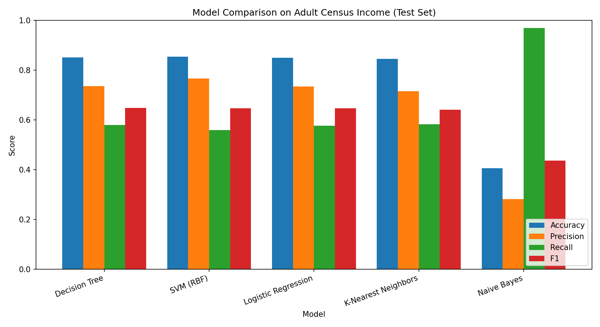

# Task 2: Supervised Learning Comparison

## About
I trained 5 supervised learning models on the same dataset to see which one works best. The dataset is Adult Census Income, and the goal is to predict whether a person earns more than $50K a year.

## Models used
1. Logistic Regression
2. Decision Tree
3. K-Nearest Neighbors
4. Support Vector Machine (SVM)
5. Naive Bayes

## What I did
- Used 20,000 rows of the dataset
- Filled missing values, scaled numbers, and one-hot encoded text columns
- Split the data once into 80% train and 20% test, and used it for all 5 models
- Measured accuracy, precision, recall and F1 score

## Results

[paste the results table here]



## Analysis

**Best model: [name]**
[2-3 sentences on why it did best]

**Worst model: [name]**
[2-3 sentences on why it did worst]

## How to run
```
pip install -r requirements.txt
```
Open `supervised_learning_comparison.ipynb` and run all cells.
